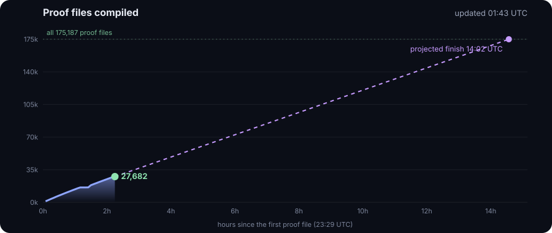

# Live: building the claimed Lean proof of the Riemann Hypothesis

🟢 **Compiling**: the original proof, all 175,187 files, on one AWS machine. Updated every 10 minutes; last update **2026-11-21 01:43 UTC**.

## 15.8% built

`██████▎░░░░░░░░░░░░░░░░░░░░░░░░░░░░░░░░░`  **27,682** of 175,187 proof files

| ⏱ Time left | 🏁 Finish (UTC) | ⚡ Rate | 💵 Spent | 💵 Projected total | ❌ Errors |
|:---:|:---:|:---:|:---:|:---:|:---:|
| 12h 19m | 14:02 | 200 files/min | $4.76 | $24 | 0 |

## By library

| Library | Built | Progress |
|---|---:|---|
| `Development` | 11,496 / 141,928 | `█▌░░░░░░░░░░░░░░░░░░` 8% |
| `Formalism` | 11,883 / 18,254 | `█████████████ ░░░░░░` 65% |
| `GroundTheory` | 880 / 8,507 | `██ ░░░░░░░░░░░░░░░░░` 10% |
| `ReciprocityTheory` | 2,127 / 3,845 | `███████████ ░░░░░░░░` 55% |
| `CompanionTheory` | 1,173 / 2,027 | `███████████▌░░░░░░░░` 58% |
| `PositivityTheory` | 0 / 449 | ` ░░░░░░░░░░░░░░░░░░░` 0% |
| `Lemmata` | 121 / 167 | `██████████████▍░░░░░` 72% |

## The machine

| | |
|---|---|
| Instance | AWS `m6a.48xlarge` Spot, Ohio, about $1.56/hour |
| CPUs | 192 vCPUs (96 cores), load 200, 34 Lean processes running |
| Memory | 31 GB used of 776 GB |
| Disk | 166 GB free of 207 GB |
| Sandbox | bubblewrap: no network, everything read-only except the build folder |
| Safety net | the disk survives termination, and is snapshotted every 2 hours |

## Just compiled

- `Development.AbelianVarietyTheory.Proofs.FormalGroupCharts.InvariantPolyOperatorCopiesTransportedLaw`
- `Formalism.SharpRestriction.Divisibility.GeneratorPowers.ChartJetSubSt`
- `Formalism.SharpRestriction.Divisibility.GeneratorPowers.CIndFrFixAsm`
- `Development.AbelianVarietyTheory.Proofs.GenericRegularity.ImNegOfFramePeriodVector`
- `ReciprocityTheory.ReductiveGroups.ArithmeticGeometry.FundamentalDomains.LowerBlockMatrices`
- `ReciprocityTheory.ReductiveGroups.ArithmeticGeometry.HeightTheory.HNormB`

## What happens when it finishes

1. **Exact reduced form.** Export the five theorems with `lean4export`. The export holds exactly the declarations the proof uses, measured by Lean itself, not guessed.
2. **Kernel race.** Check that export with Lean's kernel, **tenet-hs** (Haskell), **Tenet** (C#) and **tenet-jvm**, all timed on this same machine.
3. **Publish** the times, the verdicts and the exact size here.

## Log

- **2026-11-20 23:29 UTC:** started compiling the original proof, after the source-level reduction turned out to drop real dependencies ([why](README.md)).
- **00:39 to 00:49:** disk full. Lake's per-module `.setup.json` files reached 92 GB (about 4.6 MB each, listing every import). They are now deleted as modules finish; nothing built was lost.
- **01:45:** status counter fixed. Lake re-prints warnings for modules already built, which the old counter counted twice.

Rate and finish come from the last hour of the timestamped build log. Build method: [docs/BUILD.md](docs/BUILD.md).
