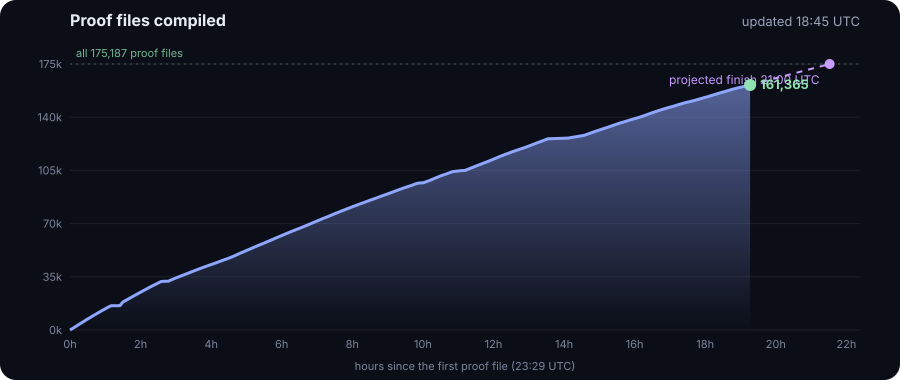

# Live: checking the claimed Lean proof of the Riemann Hypothesis

> **The goal:** find the exact, smallest form of the proof, then see whether **tenet-hs**, a Lean kernel written from scratch in Haskell, accepts it, and whether it is faster than Lean's own kernel.

**Next up: the Haskell run** (step 3) starts by itself about **21:00 UTC**, as soon as the build finishes.

🔵 **Step 1 of 6: compiling** · updated every 10 minutes · last update **2026-11-21 18:45 UTC**

## The plan

| | Step | What happens | Status |
|:---:|---|---|---|
| **1** | **Build the original** | Compile all 175,187 proof files, exactly as published. **92.1%** so far. | 🔵 **in progress** |
| **2** | **Exact reduced form** | Export the five main theorems with `lean4export`. The export holds exactly what the proof uses, measured by Lean itself. | ⏳ starts about **21:00 UTC**, when the build finishes |
| **3** | **Haskell vs Lean** | Check that export with **tenet-hs** (Haskell) and with Lean's own kernel, timed, peak memory recorded. Tenet (C#), tenet-jvm, Lean's paranoid mode, nanoda, con-leche and con-ron run in the same race. | ⏳ starts about **21:00 UTC**, when the build finishes |
| **4** | **Axioms** | List exactly which axioms the five theorems rest on. | ⏳ waiting |
| **5** | **The smallest proof** | Cut the source down to only the declarations in the export, rebuild that, and check it again with every kernel. The result is the smallest version of the proof that still compiles. | ⏳ waiting |
| **6** | **Publish** | Post the times, the verdicts and the exact sizes here. | ⏳ waiting |

Steps 2 to 4 are queued on the machine and start by themselves when the build succeeds. Step 5 follows from their output.

## Step 1: the build, 92.1%

`████████████████████████████████████▊░░░`  **161,365** of 175,187 proof files

| ⏱ Time left | 🏁 Finish (UTC) | ⚡ Rate | 💵 Spent | 💵 Projected total | ❌ Errors |
|:---:|:---:|:---:|:---:|:---:|:---:|
| 2h 15m | 21:00 | 102 files/min | $30.14 | $34 | 0 |

<b>By library</b>

| Library | Built | Progress |
|---|---:|---|
| `Development` | 128,267 / 141,928 | `██████████████████ ░` 90% |
| `Formalism` | 18,244 / 18,254 | `███████████████████▉` 100% |
| `GroundTheory` | 8,368 / 8,507 | `███████████████████▋` 98% |
| `ReciprocityTheory` | 3,841 / 3,845 | `███████████████████▉` 100% |
| `CompanionTheory` | 2,024 / 2,027 | `███████████████████▉` 100% |
| `PositivityTheory` | 449 / 449 | `████████████████████` 100% |
| `Lemmata` | 167 / 167 | `████████████████████` 100% |

<b>The machine</b>

| | |
|---|---|
| Instance | AWS `m6a.48xlarge` Spot, Ohio, about $1.56/hour |
| CPUs | 192 vCPUs (96 cores), load 192, 12 Lean processes running |
| Memory | 22 GB used of 776 GB |
| Disk | 81 GB free of 207 GB |
| Sandbox | bubblewrap: no network, everything read-only except the build folder |
| Safety net | the disk survives termination, and is snapshotted every 2 hours |

<b>Just compiled</b>

- `Development.AbelianVarietyTheory.Proofs.InertiaEigenvalues.CuspFormRapidKernelSmoothSpanSmoothCuspidalBound`
- `Development.AutomorphicArithmetic.AutomorphicVarieties.ModularityArgument.AutomorphyLifting.SubquotientSupport.LocFixed`
- `Development.AutomorphicArithmetic.AutomorphicVarieties.ModularityArgument.LinkedUnramifiedChains.ScalarIrreducibility.TanBound`
- `Development.AutomorphicArithmetic.Foundations.GaloisRepresentations.ThetaParseval.HalfIndexLattices.SplitStab`
- `Development.AutomorphicArithmetic.Foundations.GaloisRepresentations.RankTwoPatching.RatioT`
- `Development.AutomorphicArithmetic.IntegralCasts.CapelliIdentities.UnramifiedAntiInvariantLocal`

<b>Log: what went wrong and how it was handled</b>

- **2026-11-20 23:29 UTC:** started compiling the original proof, after the source-level reduction turned out to drop real dependencies ([why](README.md)).
- **00:39 to 00:49:** disk full. Lake's per-module `.setup.json` files reached 92 GB (about 4.6 MB each, listing every import). They are now deleted as modules finish; nothing built was lost.
- **01:45:** status counter fixed. Lake re-prints warnings for modules already built, which the old counter counted twice.
- **02:06 to 02:12:** AWS reclaimed the Spot machine. It stopped with its disk kept, and came back on its own when capacity returned; the build resumed with nothing lost. Everything now restarts by itself after any interruption, and progress is counted from compiled files on disk.
- **2026-11-21 09:21 to 09:24:** a second Spot interruption. The machine resumed the build by itself within a minute of coming back.
- **10:25 to 10:34:** a third Spot interruption, with no capacity for 9 minutes. Resumed by itself again; nothing lost.
- **13:04 to 13:32:** a fourth Spot interruption, 28 minutes this time. Resumed by itself again; nothing lost.

Rate and finish come from the last hour of the timestamped build log. Build method: [docs/BUILD.md](docs/BUILD.md).
