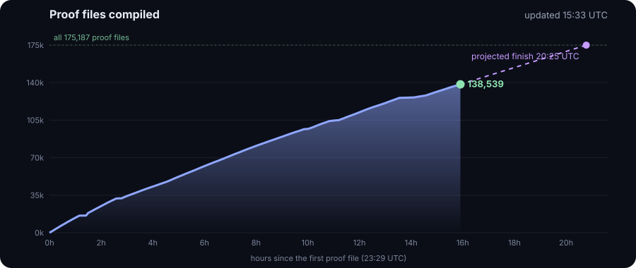

# Live: building the claimed Lean proof of the Riemann Hypothesis

🟢 **Compiling**: the original proof, all 175,187 files, on one AWS machine. Updated every 10 minutes; last update **2026-11-21 15:33 UTC**.

> **The goal:** get the exact reduced form of the proof, then check it with **Tenet-HS, a Lean kernel written from scratch in Haskell**, and race it against Lean's own kernel. Does the Haskell kernel accept the proof, and is it faster? Tenet (C#) and tenet-jvm run in the same race. The build below is step one: the kernels need the compiled proof.

## 79.1% built

`███████████████████████████████▋░░░░░░░░`  **138,539** of 175,187 proof files

| ⏱ Time left | 🏁 Finish (UTC) | ⚡ Rate | 💵 Spent | 💵 Projected total | ❌ Errors |
|:---:|:---:|:---:|:---:|:---:|:---:|
| 4h 52m | 20:25 | 125 files/min | $25.14 | $33 | 0 |

## By library

| Library | Built | Progress |
|---|---:|---|
| `Development` | 106,192 / 141,928 | `██████████████▉░░░░░` 75% |
| `Formalism` | 18,195 / 18,254 | `███████████████████▉` 100% |
| `GroundTheory` | 8,288 / 8,507 | `███████████████████▍` 97% |
| `ReciprocityTheory` | 3,794 / 3,845 | `███████████████████▋` 99% |
| `CompanionTheory` | 1,896 / 2,027 | `██████████████████▋░` 94% |
| `PositivityTheory` | 6 / 449 | `▎░░░░░░░░░░░░░░░░░░░` 1% |
| `Lemmata` | 165 / 167 | `███████████████████▊` 99% |

## The machine

| | |
|---|---|
| Instance | AWS `m6a.48xlarge` Spot, Ohio, about $1.56/hour |
| CPUs | 192 vCPUs (96 cores), load 196, 19 Lean processes running |
| Memory | 23 GB used of 776 GB |
| Disk | 95 GB free of 207 GB |
| Sandbox | bubblewrap: no network, everything read-only except the build folder |
| Safety net | the disk survives termination, and is snapshotted every 2 hours |

## Just compiled

- `Development.AbelianVarietyTheory.Proofs.DivisorProofs.FrameImageSpansGenericStalk`
- `Development.AbelianVarietyTheory.Proofs.DivisorProofs.ExistsFibrePointPolarized`
- `Development.AbelianVarietyTheory.Proofs.DivisorProofs.LintegralFibreOverCell`
- `Development.AbelianVarietyTheory.Proofs.DivisorProofs.IntegralAdaptedMinorNormsStatement`
- `Development.AutomorphicArithmetic.DivisorFrames.EigenvarietyOverFrame`
- `Development.AbelianVarietyTheory.Proofs.DivisorProofs.TorsionFiniteSemiabelianOverAlgClosedStatement`

## What happens when it finishes

**Queued on the machine; it starts by itself when the build succeeds:**

1. **Exact reduced form.** Export the five theorems with `lean4export`. The export holds exactly the declarations the proof uses, measured by Lean itself, not guessed.
2. **Haskell vs Lean.** Time **tenet-hs** (Haskell) against Lean's own kernel on that one export, with peak memory recorded. The same race also runs Lean's paranoid mode, nanoda, con-leche, con-ron, **Tenet** (C#) and **tenet-jvm**, one checker at a time so none slows another. All eight accepted a test export of the same format.
3. **Axioms.** List exactly which axioms the five theorems depend on.
4. **Publish** the times, the verdicts and the exact size here.

## Log

- **2026-11-20 23:29 UTC:** started compiling the original proof, after the source-level reduction turned out to drop real dependencies ([why](README.md)).
- **00:39 to 00:49:** disk full. Lake's per-module `.setup.json` files reached 92 GB (about 4.6 MB each, listing every import). They are now deleted as modules finish; nothing built was lost.
- **01:45:** status counter fixed. Lake re-prints warnings for modules already built, which the old counter counted twice.
- **02:06 to 02:12:** AWS reclaimed the Spot machine. It stopped with its disk kept, and came back on its own when capacity returned; the build resumed with nothing lost. Everything now restarts by itself after any interruption, and progress is counted from compiled files on disk.
- **2026-11-21 09:21 to 09:24:** a second Spot interruption. The machine resumed the build by itself within a minute of coming back.
- **10:25 to 10:34:** a third Spot interruption, with no capacity for 9 minutes. Resumed by itself again; nothing lost.
- **13:04 to 13:32:** a fourth Spot interruption, 28 minutes this time. Resumed by itself again; nothing lost.

Rate and finish come from the last hour of the timestamped build log. Build method: [docs/BUILD.md](docs/BUILD.md).
