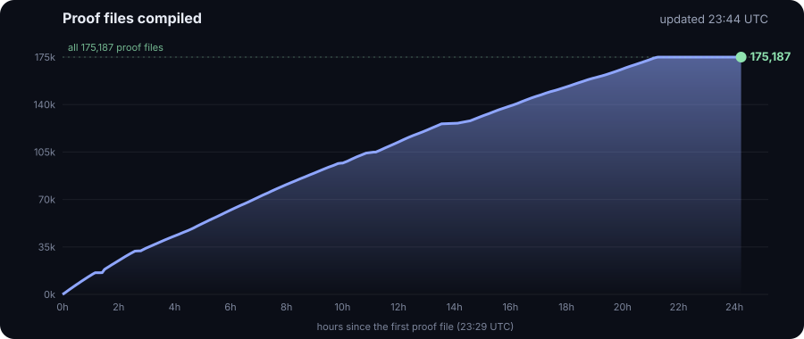

# Live: checking the claimed Lean proof of the Riemann Hypothesis

> **The goal:** find the exact, smallest form of the proof, then see whether **tenet-hs**, a Lean kernel written from scratch in Haskell, accepts it, and whether it is faster than Lean's own kernel.

**The race is on:** 8 kernels check the 61.6 GB export one at a time. tenet-hs (Haskell) runs seventh.

🔵 **Step 3 of 6: Haskell vs Lean race running** · updated every 10 minutes · last update **2026-11-21 23:44 UTC**

| The proof | Levent Alpöge, working with Claude ([remark.pdf](https://alpo.ge/remark.pdf)), announced 2026-11-20 |
|---|---|
| Source | byte-exact mirror [Deicyde/riemann-hypothesis](https://github.com/Deicyde/riemann-hypothesis) at `8b83d5e`, Lean 4.33.1, Mathlib v4.33.1 |
| Size | 175,187 files, about 17.5 million lines, 1 docstring |
| The five theorems checked | `riemannHypothesis`, `riemannZeta_eq_zero_re`, `LFunction_ne_zero_of_half_lt_re`, `LFunction_eq_zero_re`, `LFunction_eq_zero_re_of_isPrimitive` |
| Build it yourself | [docs/BUILD-ORIGINAL.md](docs/BUILD-ORIGINAL.md): one script, about 21 hours and $35 on one AWS Spot machine |

## The plan

| | Step | What happens | Status |
|:---:|---|---|---|
| **1** | **Build the original** | Compile all 175,187 proof files, exactly as published. **100.0%** so far. | ✅ done |
| **2** | **Exact reduced form** | Export the five main theorems with `lean4export`. The export holds exactly what the proof uses, measured by Lean itself. | ✅ done |
| **3** | **Haskell vs Lean** | Check that export with **tenet-hs** (Haskell) and with Lean's own kernel, timed, peak memory recorded. Tenet (C#), tenet-jvm, Lean's paranoid mode, nanoda, con-leche and con-ron run in the same race. | 🔵 **in progress** |
| **4** | **Axioms** | List exactly which axioms the five theorems rest on. | ⏳ waiting |
| **5** | **The smallest proof** | Cut the source down to only the declarations in the export, rebuild that, and check it again with every kernel. The result is the smallest version of the proof that still compiles. | ⏳ waiting |
| **6** | **Publish** | Post the times, the verdicts and the exact sizes here. | ⏳ waiting |

Steps 2 to 4 are queued on the machine and start by themselves when the build succeeds. Step 5 follows from their output.

## Step 2 result: the exact reduced form

Exported from the unmodified build with `lean4export` 3.1.0 (Lean 4.33.1), in the no-network sandbox, starting from the five main theorems. This is everything the proof uses, measured by Lean itself, including the parts of Mathlib and Lean's core library it needs.

| | |
|---|---|
| Declarations | **1,468,414**: 1,246,109 theorems, 214,238 definitions, 7,969 inductive types, 91 opaque, 4 quotient |
| Axioms | **3, all Lean's standard ones:** `propext`, `Quot.sound`, `Classical.choice` |
| Size | 61.6 GB of NDJSON, 1,065,214,329 expressions, 14,065,146 names |
| Export time | 2 h 17 m, 163 GB peak memory, exit 0 |
| sha256 | `4301ce4828d397c728e87f3e6a1251aa42abe5e12809bb9e0b73cc3d33072e7e` |

## Step 3: the kernel race, Haskell vs Lean

Each checker reads the same 61.6 GB export and checks every declaration from scratch, one checker at a time so none slows another. Wall time is real time; CPU about equal to wall time means one core.

| # | Checker | What it is | Verdict | Wall time | CPU | Peak memory |
|:---:|---|---|:---:|---:|---:|---:|
| 1 | Lean's kernel | Lean 4.36's own type checker, the reference | 🔵 **checking** | 0h 20m so far | 1,246 s | 70 GB now |
| 2 | Lean paranoid | the same kernel with extra checks | ⏳ queued | | | |
| 3 | nanoda | independent kernel in Rust | ⏳ queued | | | |
| 4 | con-leche | independent checker | ⏳ queued | | | |
| 5 | con-ron | independent checker | ⏳ queued | | | |
| 6 | **Tenet** | written from scratch in C# ([repo](https://github.com/keithadler/tenet)) | ⏳ queued | | | |
| 7 | **tenet-hs** | written from scratch in **Haskell** ([repo](https://github.com/keithadler/tenet-hs)) | ⏳ queued | | | |
| 8 | **tenet-jvm** | written from scratch for the JVM ([repo](https://github.com/keithadler/tenet-jvm)) | ⏳ queued | | | |

## Step 1: the build ✅ done

`████████████████████████████████████████`  **175,187** of 175,187 proof files · `Build completed successfully (183893 jobs)`

| ⏱ Compiling time | 🏁 Finished (UTC) | 💵 Build cost | 💵 Spent so far | ❌ Errors | 🚫 sorry |
|:---:|:---:|:---:|:---:|:---:|:---:|
| about 21 h | 2026-11-21 20:52 | $33.43 | $37.91 | 0 | 0 |

Spent so far keeps counting while the machine runs steps 2 to 4.

<b>By library</b>

| Library | Built | Progress |
|---|---:|---|
| `Development` | 141,928 / 141,928 | `████████████████████` 100% |
| `Formalism` | 18,254 / 18,254 | `████████████████████` 100% |
| `GroundTheory` | 8,507 / 8,507 | `████████████████████` 100% |
| `ReciprocityTheory` | 3,845 / 3,845 | `████████████████████` 100% |
| `CompanionTheory` | 2,027 / 2,027 | `████████████████████` 100% |
| `PositivityTheory` | 449 / 449 | `████████████████████` 100% |
| `Lemmata` | 167 / 167 | `████████████████████` 100% |

<b>The machine</b>

| | |
|---|---|
| Instance | AWS `m6a.48xlarge` Spot, Ohio, about $1.56/hour |
| CPUs | 192 vCPUs (96 cores), load 1, 0 Lean processes running |
| Memory | 77 GB used of 776 GB |
| Disk | 431 GB free of 623 GB |
| Sandbox | bubblewrap: no network, everything read-only except the build folder |
| Safety net | the disk survives termination, and is snapshotted every 2 hours |

<b>Log: what went wrong and how it was handled</b>

- **2026-11-20 23:29 UTC:** started compiling the original proof, after the source-level reduction turned out to drop real dependencies ([why](README.md)).
- **00:39 to 00:49:** disk full. Lake's per-module `.setup.json` files reached 92 GB (about 4.6 MB each, listing every import). They are now deleted as modules finish; nothing built was lost.
- **01:45:** status counter fixed. Lake re-prints warnings for modules already built, which the old counter counted twice.
- **02:06 to 02:12:** AWS reclaimed the Spot machine. It stopped with its disk kept, and came back on its own when capacity returned; the build resumed with nothing lost. Everything now restarts by itself after any interruption, and progress is counted from compiled files on disk.
- **2026-11-21 09:21 to 09:24:** a second Spot interruption. The machine resumed the build by itself within a minute of coming back.
- **10:25 to 10:34:** a third Spot interruption, with no capacity for 9 minutes. Resumed by itself again; nothing lost.
- **13:04 to 13:32:** a fourth Spot interruption, 28 minutes this time. Resumed by itself again; nothing lost.
- **20:52:38: build finished.** `Build completed successfully (183893 jobs)`: all 175,187 proof files, 0 errors, no `sorry`, 6 h 56 m of compiling since the last restart. The export (step 2) started at 20:53.
- **21:30:** the export file was growing toward the disk's limit (51 GB free, about 0.66 GB a minute). The disk was grown from 200 GB to 600 GB while running; nothing stopped.
- **23:10: export finished.** 1,468,414 declarations, 61.6 GB, exit 0, in 2 h 17 m. Only Lean's three standard axioms appear.
- **23:22: the kernel race started** with Lean's kernel.

Rate and finish come from the last hour of the timestamped build log. Build it yourself: [docs/BUILD-ORIGINAL.md](docs/BUILD-ORIGINAL.md).
