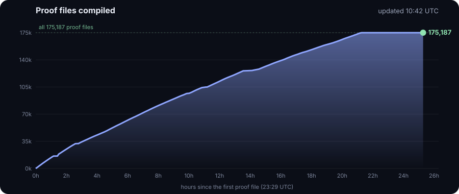

# Live: checking the claimed Lean proof of the Riemann Hypothesis

> **The goal:** find the exact, smallest form of the proof, then see whether **tenet-hs**, a Lean kernel written from scratch in Haskell, accepts it, and whether it is faster than Lean's own kernel.

🔵 **Step 4 of 6: listing axioms** · updated every 2 minutes · last update **2026-11-22 10:42 UTC**

| The proof | Levent Alpöge, working with Claude ([remark.pdf](https://alpo.ge/remark.pdf)), announced 2026-11-20 |
|---|---|
| Source | byte-exact mirror [Deicyde/riemann-hypothesis](https://github.com/Deicyde/riemann-hypothesis) at `8b83d5e`, Lean 4.33.1, Mathlib v4.33.1 |
| Size | 175,187 files, about 17.5 million lines, 1 docstring |
| The five theorems checked | `riemannHypothesis`, `riemannZeta_eq_zero_re`, `LFunction_ne_zero_of_half_lt_re`, `LFunction_eq_zero_re`, `LFunction_eq_zero_re_of_isPrimitive` |
| Build it yourself | [docs/BUILD-ORIGINAL.md](docs/BUILD-ORIGINAL.md): one script, about 21 hours and $35 on one AWS Spot machine |

## The plan

| | Step | What happens | Status | 💵 Cost |
|:---:|---|---|---|---:|
| **1** | **Build the original** | Compile all 175,187 proof files, exactly as published. **100.0%** so far. | ✅ done | $33.43 |
| **2** | **Exact reduced form** | Export the five main theorems with `lean4export`. The export holds exactly what the proof uses, measured by Lean itself. | ✅ done | $3.90 |
| **3** | **Haskell vs Lean** | Check that export with **tenet-hs** (Haskell) and with Lean's own kernel, timed, peak memory recorded. Tenet (C#), tenet-jvm, Lean's paranoid mode, nanoda, con-leche and con-ron run in the same race. | ✅ done | $17.69 |
| **4** | **Axioms** | List exactly which axioms the five theorems rest on. | 🔵 **in progress** | not started |
| **5** | **The smallest proof** | Cut the source to only what the export says the theorems use, merge repeated theorems, rebuild, and check it with Tenet, then the other kernels. **Round 2 building: 15.45M lines (−11.1%) in 32,034 files (−81.7%).** [Details](docs/MINIFY.md) | 🔵 **in progress** | not started |
| **6** | **Publish** | Post the times, the verdicts and the exact sizes here. | ⏳ waiting | not started |

**Total so far: $55.02**, at the Spot rate of about $1.56 an hour. The disk (now 600 GB) and its snapshots add about $2 a day.

Steps 2 to 4 are queued on the machine and start by themselves when the build succeeds. Step 5 follows from their output.

## Step 2 result: the exact reduced form

Exported from the unmodified build with `lean4export` 3.1.0 (Lean 4.33.1), in the no-network sandbox, starting from the five main theorems. This is everything the proof uses, measured by Lean itself, including the parts of Mathlib and Lean's core library it needs.

| | |
|---|---|
| Declarations | **1,468,414**: 1,246,109 theorems, 214,238 definitions, 7,969 inductive types, 91 opaque, 4 quotient |
| Axioms | **3, all Lean's standard ones:** `propext`, `Quot.sound`, `Classical.choice` |
| Size | 61.6 GB of NDJSON, 1,065,214,329 expressions, 14,065,146 names |
| Export time | 2 h 17 m, 163 GB peak memory, exit 0 |
| sha256 | `4301ce4828d397c728e87f3e6a1251aa42abe5e12809bb9e0b73cc3d33072e7e` |

## Step 3: the kernel race, Haskell vs Lean

Each checker reads the same 61.6 GB export and checks every declaration from scratch. Lean's kernel started alone at 23:22 UTC; at 00:38 the other seven were started alongside it, because each uses one core (Tenet uses many) and the machine has 192 vCPUs, so running them one at a time left it idle at the same hourly cost. Each runs in its own memory-capped sandbox. Running together can slow each a little (shared memory bandwidth); if two kernels finish close together, they will be re-timed alone.

| # | Checker | What it is | Verdict | Wall time | CPU | Peak memory |
|:---:|---|---|:---:|---:|---:|---:|
| 1 | Lean's kernel | Lean 4.36's own type checker, the reference | ⏳ queued | | | |
| 2 | Lean paranoid | the same kernel with extra checks | ⏹ stopped at 05:37 UTC by an AWS Spot interruption after about 5 h; no verdict | | | |
| 3 | nanoda | independent kernel in Rust | ⏹ stopped at 05:37 UTC by an AWS Spot interruption after about 5 h; no verdict | | | |
| 4 | con-leche | independent checker, formally verified mode | ⚪ declined: no support for reflexive inductive types | 6:07.52 | 328 s | 37.1 GB |
| 5 | con-ron | independent checker, formally verified mode | ⚪ declined: no support for reflexive inductive types | 5:14.61 | 248 s | 53.1 GB |
| 6 | con-leche, trusted mode | every check the official kernel does, outside its formal theorem | ⚪ declined: no support for reflexive inductive types | 6:48.95 | 356 s | 37.1 GB |
| 7 | con-ron, trusted mode | the same, for con-ron | ⚪ declined: no support for reflexive inductive types | 4:45.75 | 253 s | 53.1 GB |
| 8 | **Tenet** | written from scratch in C# ([repo](https://github.com/keithadler/tenet)) | ✅ accepts | 1:00:27 | 252,006 s | 236.1 GB |
| 9 | **tenet-hs** | written from scratch in **Haskell** ([repo](https://github.com/keithadler/tenet-hs)) | ⏹ stopped at 05:37 UTC by an AWS Spot interruption after about 5 h; no verdict | | | |
| 10 | **tenet-jvm** | written from scratch for the JVM ([repo](https://github.com/keithadler/tenet-jvm)) | ⏸ stopped: stuck about 90 min reading one declaration while memory grew; not a verdict | 2:02:16 | 15,818 s | 257.7 GB |

## Step 5: building the smallest proof

The minified source, round 2 (15,445,263 lines in 32,034 files, down from 17,374,242 lines in 175,188: see [docs/MINIFY.md](docs/MINIFY.md)) is compiling on the same machine, network cut off, since 06:19:37 UTC on 2026-11-22. When it builds, its export is checked by Tenet first, then the other kernels.

🔵 **compiling** · `████████████▌░░░░░░░░░░░░░░░░░░░░░░░░░░░` **12,307** of 39,281 Lake jobs (31.3%) · ❌ errors: **557**

| Round | Started (UTC) | Lines | Files | Errors | What changed |
|---|---|---:|---:|---:|---|
| round 1 | 06:19 | 13,850,849 | 30,698 | 5 | exact cut from the export; stopped: kept instances lost their dependencies |
| round 2 | 06:27 | 15,445,263 | 32,034 | 298 | keep what kept instances depend on; stopped: tactics name unused lemmas |
| round 3 | 06:36 | 15,565,484 | 172,254 | 171 | keep everything kept code mentions; built unmerged |
| round 4 | 06:42 | 15,567,987 | 172,254 | 2114 | restore names the parser misread; automatic repair from here |
| round 5 | 07:41 | 15,588,885 | 172,263 | 1024 | automatic repair of the previous round |
| round 6 | 08:07 | 15,598,652 | 172,271 | 538 | automatic repair of the previous round |
| round 7 | 08:32 | 15,602,807 | 172,276 | 828 | automatic repair of the previous round |
| round 8 | 08:57 | 15,610,005 | 172,278 | 492 | automatic repair of the previous round |
| round 9 | 09:22 | 15,611,871 | 172,280 | 1859 | automatic repair of the previous round |
| round 10 | 09:51 | 15,620,035 | 172,286 | 528 | automatic repair of the previous round |
| round 11 | 10:17 | 15,621,208 | 172,286 | 473 | automatic repair of the previous round |

Lake counts jobs, not files: the job total includes the already-built Mathlib and grows as Lake discovers work. An error here most likely means a declaration needed only while building a proof was cut; it goes back and the build resumes.

## Research on the export

Six tests that only an exact export plus several independent kernels make possible. They run on the same machine, alongside the race, at no extra cost. None of them checks the mathematics: they are about the proof as an artifact, and about the checkers.

| # | Test | What it shows | Status |
|:---:|---|---|---|
| 1 | **Mutation test the kernels** | Plant one fault at a time in a proof term and give every mutant to all six kernels. All should reject; any disagreement between kernels is a finding. | 🟢 **431 faults planted in 8 real slices of the proof (1.1M to 7.2M lines each), 2,583 kernel checks: all 6 kernels accepted every clean slice and rejected every fault.** No disagreements. (The last slice was cut short by a Spot interruption.) |
| 2 | **Where the checking time goes** | The declarations that take most of the kernel time, from Tenet's per-declaration report. | 🟢 **0.3% of the declarations take half of the checking.** In Tenet's run, 4,335 declarations (of 1,468,414) took over 5 s each and add up to 128,568 CPU-seconds, 51% of its 252,006. 494 took over a minute, 22 over five minutes; the slowest, `CrystallineSemistableComparison.fc_range_le`, took 687 s. By area, p-adic Hodge theory dominates: `CrystallineSemistableComparison` 15% of the slow time and `GroundTheory.PAdicHodge` another 4%, then `GroundTheory.Arith` 7% and the étale cohomology parts. Reading the 61.6 GB file took 3,075 s of Tenet's 3,459 s wall time, overlapped with checking. |
| 3 | **Duplicate theorems** | Theorems proved more than once with an identical statement, project vs Mathlib. | 🟢 **96,761 hand-named theorems repeat another theorem's statement exactly** (69,144 groups; equal up to bound-variable names; Lean's auto-generated helpers left out). Many are two proofs of the same named `Statement` proposition. For scale: 1,075,024 theorems are the project's own. |
| 4 | **The trusted base** | What a person must read to trust the five STATEMENTS, as opposed to the 1.47M declarations of proof. | 🟢 first result: `riemannHypothesis` is stated with Mathlib's own definition only. `LFunction_eq_zero_re_of_isPrimitive` goes through a project-defined wrapper, `PrimitiveDirichletLZerosOnLine`, the kind of place a wrong definition could hide (Comparator's statement check covers it). Full count: the five statements rest on **4,915 declarations**, only **5** of them from the project (four statement wrappers and one helper); the other 4,910 are Mathlib and Lean. |
| 5 | **The spine and the hubs** | The chain of declarations every dependency path must pass through (a dominator tree), and the most-used lemmas. | 🟢 **99.35% of the proof sits under one claim, `allChi`** (`UpperTheory.FinalTheorems.everyCharacter`). Below it: `everyCharacter_of_row` owns 77%, `every_character_of_literature_of_vWin` 67%, `every_character_of_theta_integrals_local_matching` 43%: the same chain traced by hand earlier, now measured. Top hub: `Formalism.BasicNotions.D7`, used directly by 155,523 declarations. Of the 1,468,414 declarations, 1,258,876 (86%) are the project's, holding 97% of the expression nodes. |
| 6 | **Haskell vs Lean per slice** | tenet-hs and Lean's kernel timed on the same slices, matched by size, for a fair speed comparison. | 🔵 first slice, clean file, wall time with 24 checks running at once (so rough): nanoda 7.4 s, Tenet 9.8 s, Lean 11.4 s, Lean paranoid 14.8 s, **tenet-hs 16.8 s**, tenet-jvm 17.1 s. Fair timings, one at a time on an idle machine, come after the race. |

## Step 1: the build ✅ done

`████████████████████████████████████████`  **175,187** of 175,187 proof files · `Build completed successfully (183893 jobs)`

| ⏱ Compiling time | 🏁 Finished (UTC) | 💵 Build cost | 💵 Spent so far | ❌ Errors | 🚫 sorry |
|:---:|:---:|:---:|:---:|:---:|:---:|
| about 21 h | 2026-11-21 20:52 | $33.43 | $55.02 | 0 | 0 |

Spent so far keeps counting while the machine runs steps 2 to 4.

<b>By library</b>

| Library | Built | Progress |
|---|---:|---|
| `Development` | 141,928 / 141,928 | `████████████████████` 100% |
| `Formalism` | 18,254 / 18,254 | `████████████████████` 100% |
| `GroundTheory` | 8,507 / 8,507 | `████████████████████` 100% |
| `ReciprocityTheory` | 3,845 / 3,845 | `████████████████████` 100% |
| `CompanionTheory` | 2,027 / 2,027 | `████████████████████` 100% |
| `PositivityTheory` | 449 / 449 | `████████████████████` 100% |
| `Lemmata` | 167 / 167 | `████████████████████` 100% |

<b>The machine</b>

| | |
|---|---|
| Instance | AWS `m6a.48xlarge` Spot, Ohio, about $1.56/hour |
| CPUs | 192 vCPUs (96 cores), load 17, 0 Lean processes running |
| Memory | 6 GB used of 776 GB |
| Disk | 252 GB free of 623 GB |
| Sandbox | bubblewrap: no network, everything read-only except the build folder |
| Safety net | the disk survives termination, and is snapshotted every 2 hours |

<b>Log: what went wrong and how it was handled</b>

- **2026-11-20 23:29 UTC:** started compiling the original proof, after the source-level reduction turned out to drop real dependencies ([why](README.md)).
- **00:39 to 00:49:** disk full. Lake's per-module `.setup.json` files reached 92 GB (about 4.6 MB each, listing every import). They are now deleted as modules finish; nothing built was lost.
- **01:45:** status counter fixed. Lake re-prints warnings for modules already built, which the old counter counted twice.
- **02:06 to 02:12:** AWS reclaimed the Spot machine. It stopped with its disk kept, and came back on its own when capacity returned; the build resumed with nothing lost. Everything now restarts by itself after any interruption, and progress is counted from compiled files on disk.
- **2026-11-21 09:21 to 09:24:** a second Spot interruption. The machine resumed the build by itself within a minute of coming back.
- **10:25 to 10:34:** a third Spot interruption, with no capacity for 9 minutes. Resumed by itself again; nothing lost.
- **13:04 to 13:32:** a fourth Spot interruption, 28 minutes this time. Resumed by itself again; nothing lost.
- **20:52:38: build finished.** `Build completed successfully (183893 jobs)`: all 175,187 proof files, 0 errors, no `sorry`, 6 h 56 m of compiling since the last restart. The export (step 2) started at 20:53.
- **21:30:** the export file was growing toward the disk's limit (51 GB free, about 0.66 GB a minute). The disk was grown from 200 GB to 600 GB while running; nothing stopped.
- **23:10: export finished.** 1,468,414 declarations, 61.6 GB, exit 0, in 2 h 17 m. Only Lean's three standard axioms appear.
- **23:22: the kernel race started** with Lean's kernel.
- **00:43 and 00:44:** con-ron and con-leche **declined** in their default, formally verified mode: the proof uses a reflexive inductive type (`FunctorialResolution.EmbeddedResolution.PrincipalizationCertificate`), which their verified model doesn't cover. That is not a rejection of the proof. Both were restarted at 00:45 in trusted mode, which runs every check the official kernel does.
- **00:50 and 00:52:** both declined again in trusted mode, at the same type. So con-leche and con-ron don't support reflexive inductive types in either mode; they give no verdict on this proof.
- **03:08:** Tenet stopped after checking **1,468,255 of 1,468,414 declarations, 0 failed**: it ran out of memory on the last 159. The cause was the race setup, not Tenet or the proof: its sandbox was capped at 120 GB, and .NET limits its heap to 75% of that (peak 89.7 GB). Rerun from 03:16 with a 320 GB cap.
- **05:37 to 05:46:** a fifth Spot interruption. It stopped the four checkers still running: Lean's kernel (about 6 h in), paranoid mode, nanoda and tenet-hs, with no verdicts. Everything on disk was kept. The race is not restarted for now; the machine now builds the minified proof, which Tenet will check, and the other kernels after that.
- **04:16:55: Tenet accepts the whole proof.** All 1,468,414 declarations checked, 0 failed, exit 0, in 1 h 0 m 27 s (peak 236 GB). Tenet is an independent Lean kernel written from scratch in C#, and the first of the from-scratch kernels to finish.
- **03:17:** tenet-jvm stopped by hand. It had been stuck for about 90 minutes reading one declaration (`Formalism.MainNotions.FormalGroupSystem.Pf.ea_card_img._simp_1_1`) while its memory grew to 258 GB. Recorded as stalled, not as a verdict; to be reproduced on a small export of that lemma.
- **00:38:** switched to a parallel race. Each checker uses one core, so the other seven now run alongside Lean's kernel instead of after it, each in its own memory-capped sandbox. Same hourly cost, results hours sooner.

Rate and finish come from the last hour of the timestamped build log. Build it yourself: [docs/BUILD-ORIGINAL.md](docs/BUILD-ORIGINAL.md).
