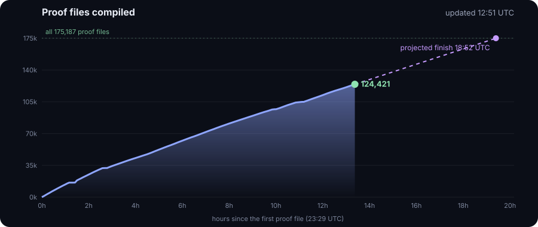

# Live: building the claimed Lean proof of the Riemann Hypothesis

🟢 **Compiling**: the original proof, all 175,187 files, on one AWS machine. Updated every 10 minutes; last update **2026-11-21 12:51 UTC**.

## 71.0% built

`████████████████████████████▍░░░░░░░░░░░`  **124,421** of 175,187 proof files

| ⏱ Time left | 🏁 Finish (UTC) | ⚡ Rate | 💵 Spent | 💵 Projected total | ❌ Errors |
|:---:|:---:|:---:|:---:|:---:|:---:|
| 6h 01m | 18:52 | 140 files/min | $21.67 | $31 | 0 |

## By library

| Library | Built | Progress |
|---|---:|---|
| `Development` | 92,925 / 141,928 | `█████████████ ░░░░░░` 65% |
| `Formalism` | 18,160 / 18,254 | `███████████████████▉` 99% |
| `GroundTheory` | 7,502 / 8,507 | `█████████████████▋░░` 88% |
| `ReciprocityTheory` | 3,771 / 3,845 | `███████████████████▌` 98% |
| `CompanionTheory` | 1,889 / 2,027 | `██████████████████▋░` 93% |
| `PositivityTheory` | 6 / 449 | `▎░░░░░░░░░░░░░░░░░░░` 1% |
| `Lemmata` | 165 / 167 | `███████████████████▊` 99% |

## The machine

| | |
|---|---|
| Instance | AWS `m6a.48xlarge` Spot, Ohio, about $1.56/hour |
| CPUs | 192 vCPUs (96 cores), load 193, 17 Lean processes running |
| Memory | 21 GB used of 776 GB |
| Disk | 103 GB free of 207 GB |
| Sandbox | bubblewrap: no network, everything read-only except the build folder |
| Safety net | the disk survives termination, and is snapshotted every 2 hours |

## Just compiled

- `Development.AutomorphicSpectrum.Proofs.GeometryProofs.KillsOverSquareZeroLiftStatement`
- `Development.AutomorphicSpectrum.Proofs.GeometryProofs.FiniteExtensionCoordsCompareStatement`
- `Development.WeilBound.CoreStatements.TorusUniformisation.ChowMahlerFamilies.PolynomialNormSquareSmooth`
- `Development.AutomorphicSpectrum.Proofs.MetricProofs.FcHoloDetDifferentiableAt`
- `Development.AutomorphicSpectrum.Proofs.MetricProofs.FlagAdjacentTwistedResolutionFifth`
- `Development.AutomorphicSpectrum.Proofs.GeometryProofs.MapDomainRelationLiftCommutingSquare`

## What happens when it finishes

**Queued on the machine; it starts by itself when the build succeeds:**

1. **Exact reduced form.** Export the five theorems with `lean4export`. The export holds exactly the declarations the proof uses, measured by Lean itself, not guessed.
2. **Kernel race.** Check that one export, one checker at a time, each timed with peak memory recorded: Lean's kernel, its paranoid mode, nanoda, con-leche, con-ron, and the three clean-room kernels **Tenet** (C#), **tenet-hs** (Haskell) and **tenet-jvm**. All eight accepted a test export of the same format.
3. **Axioms.** List exactly which axioms the five theorems depend on.
4. **Publish** the times, the verdicts and the exact size here.

## Log

- **2026-11-20 23:29 UTC:** started compiling the original proof, after the source-level reduction turned out to drop real dependencies ([why](README.md)).
- **00:39 to 00:49:** disk full. Lake's per-module `.setup.json` files reached 92 GB (about 4.6 MB each, listing every import). They are now deleted as modules finish; nothing built was lost.
- **01:45:** status counter fixed. Lake re-prints warnings for modules already built, which the old counter counted twice.
- **02:06 to 02:12:** AWS reclaimed the Spot machine. It stopped with its disk kept, and came back on its own when capacity returned; the build resumed with nothing lost. Everything now restarts by itself after any interruption, and progress is counted from compiled files on disk.
- **2026-11-21 09:21 to 09:24:** a second Spot interruption. The machine resumed the build by itself within a minute of coming back.
- **10:25 to 10:34:** a third Spot interruption, with no capacity for 9 minutes. Resumed by itself again; nothing lost.

Rate and finish come from the last hour of the timestamped build log. Build method: [docs/BUILD.md](docs/BUILD.md).
