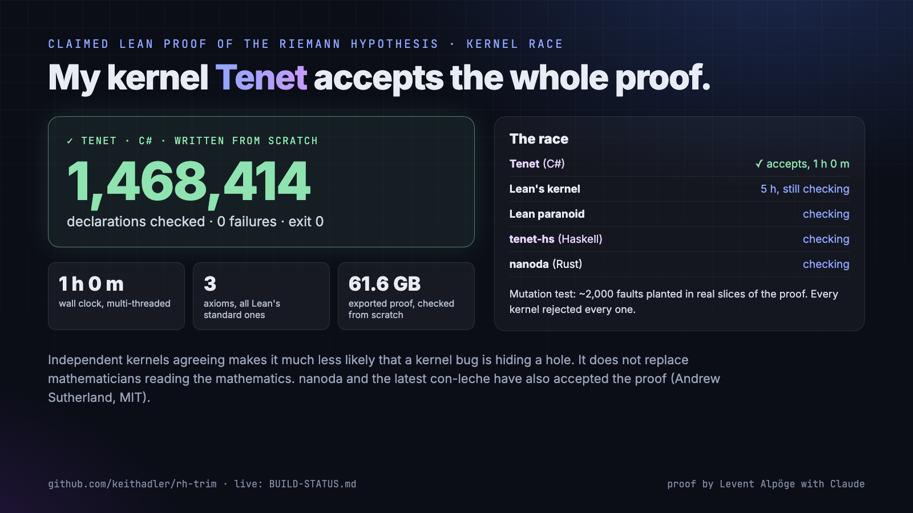
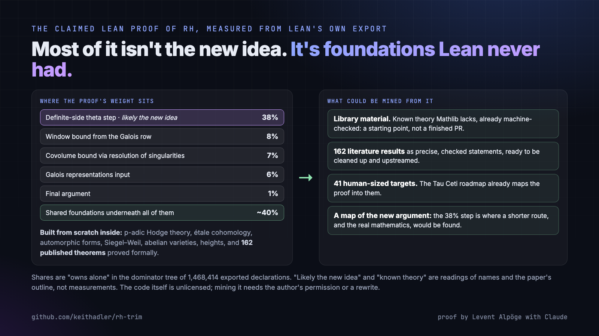
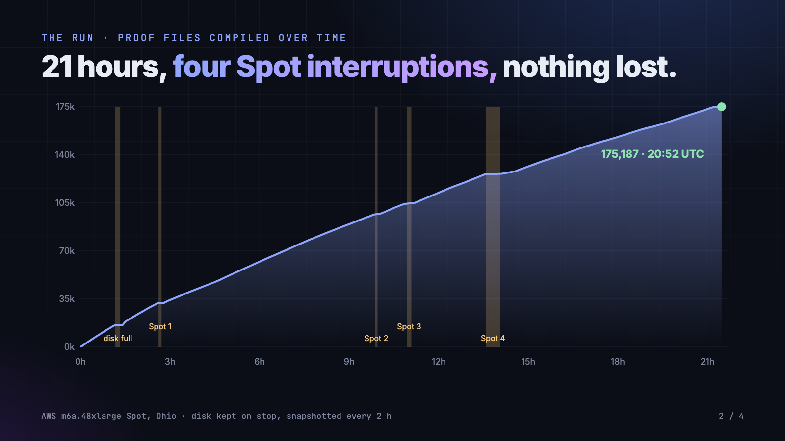

<div align="center">

# rh-trim

### Checking, mapping and shrinking the claimed Lean proof of the Riemann Hypothesis


-accepts-1f6f43)


**[Live status](BUILD-STATUS.md)** · **[The smallest proof](docs/MINIFY.md)** · **[Build it yourself](docs/BUILD-ORIGINAL.md)** · **[Proof map](docs/PROOF-MAP.md)**

</div>

<!-- STATUS:BEGIN -->
<div align="center">

**The smallest proof, live** · round 49 · 🔁 REPAIRING · updated 03:35 UTC Nov 23

<table><tr>
<td align="center" width="20%"><sub><b>SMALLER</b></sub><h2>8.4%</h2><sub>in lines, so far</sub></td>
<td align="center" width="20%"><sub><b>LINES</b></sub><h2>15.92M</h2><sub>was 17.37M</sub></td>
<td align="center" width="20%"><sub><b>FILES</b></sub><h2>~32,000</h2><sub>was 175,188 · after small files are merged</sub></td>
<td align="center" width="20%"><sub><b>THIS ROUND</b></sub><h2>0% built</h2><sub>0 of 172,454 files · 190 errors to repair</sub></td>
<td align="center" width="20%"><sub><b>TIME</b></sub><h2>21h 15m</h2><sub>and counting · since the first build, 06:19 UTC Nov 22 · 50 rounds</sub></td>
</tr></table>

<sub>Not confirmed until a round builds with 0 errors. Each round keeps what the last one's build said was missing, so the percentage can only go down from here. Updated every 2 minutes from the build machine. <a href="docs/MINIFY.md#log">Log of every round</a></sub>

</div>
<!-- STATUS:END -->

## In plain English

On 2026-11-20 Levent Alpöge announced a proof of the Riemann Hypothesis, found working with Claude and published
as a computer-checkable proof in the Lean language ([announcement](https://alpo.ge/remark.pdf)). It is enormous:
**175,188 files and 17.4 million lines**, about 7 times the size of Lean's entire math library, with a single docstring
in all of it.

We built it, asked several independent checking programs to verify it, measured what it is made of, and are cutting it
down to the smallest version that still checks. Here is what we know so far.

## Three questions, three answers

<table>
<tr><td width="33%" valign="top">

### ✅ Does it check?

**Yes, so far.** It compiles with 0 errors.
Two independent checkers have accepted all
**1,468,414** of its building blocks:
**Tenet** (in 1 hour) and **nanoda**.
Four more are still running. It relies only on
Lean's 3 standard axioms.

[Scoreboard ↓](#the-checker-scoreboard)

</td><td width="33%" valign="top">

### 🧱 What is it made of?

**Mostly foundations.** The final argument needs
only **6.6%** of the proof. The rest builds the
tools it needs, much of it established math that
Lean's library never had. One step alone owns
**38%**, and is likely where the new idea lives.

[The map ↓](#what-it-is-made-of)

</td><td width="33%" valign="top">

### ✂️ How small can it be?

**About 8% smaller so far,** all dead code,
and still being confirmed by building it. Real
savings need a shorter route through the math,
and the 38% step is the place to look.

[The smallest proof ↓](#the-smallest-proof)

</td></tr>
</table>

## The checker scoreboard

A **checker** (or kernel) is a small program that re-verifies every step of a finished proof. Several independent
ones, written by different people in different languages, make a hidden bug much less likely. All of them check the
same 61.6 GB file exported from the proof.

| Checker | Written in | Result |
|---|---|---|
| **Tenet** | C# (mine) | ✅ accepts all 1,468,414 · 1 hour |
| **nanoda** | Rust | ✅ accepts · 2 h 42 m on 32 threads |
| Lean's own kernel | C++ | 🔵 still checking (single-threaded) |
| Lean, paranoid mode | C++ | 🔵 still checking |
| **tenet-hs** | Haskell (mine) | 🔵 still checking |
| **tenet-jvm** | Java (mine) | 🔵 checking, after a fix for one theorem it used to hang on |
| con-leche, con-ron (Lean 4.36 bundle) | Lean | ⚪ decline: no support for one kind of type the proof uses |

<p align="center"></p>

We also planted **431 deliberate mistakes** in pieces of the proof: every checker caught every one.
Live times and memory: [BUILD-STATUS.md](BUILD-STATUS.md).

## What it is made of

<p align="center"></p>

- **One claim carries everything:** 99.35% of the proof sits under a single statement, `allChi`.
- **The statements are small:** what the five main theorems *say* rests on just 4,915 building blocks.
- **The cost is lopsided:** 0.3% of the building blocks take half of all checking time.
- **It repeats itself:** about 96,000 theorems restate another theorem word for word.
- **What could be mined from it:** checked versions of established theory Lean's library lacks, 162 published results
  as precise statements, and 41 targets mapped by the [Tau Ceti roadmap](https://github.com/TauCetiProject/TauCetiRoadmap/pull/2954)
  ([our weights for each](docs/TAUCETI-WEIGHTS.md)). The code is unlicensed, so reuse needs the author's permission or a rewrite.

Which parts are "new" and which "known" is our reading of names and the paper's outline; the percentages are measured.

## The smallest proof

| | Lines | Files |
|---|---:|---:|
| Original | 17,374,242 | 175,188 |
| **Smallest so far** (live numbers in the counter at the top) | about 8% fewer | about 32,000 once small files are merged |
| Lean's math library, for scale | 2,293,877 | 8,311 |

- **What gets removed:** building blocks nothing in the proof uses, files left empty, repeated theorems pointed at one
  copy, and redundant imports. No mathematics is simplified.
- **How:** an automatic loop builds it, reads the errors, puts back what was needed, and builds again, until a round
  builds with 0 errors. Every round is logged in [docs/MINIFY.md](docs/MINIFY.md#log).
- **Why only ~8%:** checkers only ever look at what the theorems use, so dead code was never the real weight. The proof
  is big because of what it *uses*.

## Words used here

| Word | Meaning |
|---|---|
| **Declaration** | one building block of the proof: a definition or a theorem |
| **Export** | one file listing every declaration the five main theorems use, written by Lean itself |
| **Kernel / checker** | a small program that re-checks every declaration from scratch |
| **Owns alone** | the share of the proof you can only reach through that one step: remove it and that share goes with it |
| **Axiom** | something assumed rather than proved; this proof uses only Lean's three standard ones |

## 🏗️ Build the original yourself

<p align="center"></p>

```bash
git clone https://github.com/keithadler/rh-trim && cd rh-trim
```

```bash
./build-original.sh ~/rh-build
```

One script, on a throwaway Ubuntu machine: installs Lean, clones the proof at a pinned commit and compiles it
with the network cut off. About 21 hours and $35 on an AWS Spot `m6a.48xlarge`. Step-by-step guide:
[docs/BUILD-ORIGINAL.md](docs/BUILD-ORIGINAL.md). To help build it with others, see the distributed replay at
[rohanarun/alpoge-rh-replay](https://github.com/rohanarun/alpoge-rh-replay).

## 🗺️ What the proof looks like inside

```
five theorems ← short arguments over Mathlib ← ONE KEY CLAIM ← Galois representations ← theta lifts
```

- **The key claim:** no Dirichlet L-function vanishes right of `Re s = 1/2`. RH and the GRH statements follow
  from it by the functional equation, in a few short files.
- **Where it comes from:** Galois representations attached to polarized cuspidal representations, derived from
  **theta lifts** rather than the geometry of Shimura varieties.
- **Nothing from the literature is assumed:** its 162 formal statements of published results are proved inside
  the project ([list](docs/LITERATURE.md)).
- **Seven theorems conclude the key claim:** five form the chain the proof uses; two are side routes it doesn't.

Layer by layer, with files: [docs/PROOF-MAP.md](docs/PROOF-MAP.md). The [Tau Ceti roadmap](https://github.com/TauCetiProject/TauCetiRoadmap/pull/2954)
turns the proof into 41 human-sized targets; [our measured weights for each](docs/TAUCETI-WEIGHTS.md).

## 🚫 What this repository is not

- **Not the proof's code.** It was published without a license, so no Lean source from it is here. The tools
  regenerate everything from the public mirror.
- **Not a verdict on the mathematics.** Kernels accepting a proof says the code checks; it doesn't replace
  mathematicians reading the math.

<details><summary><b>📁 Everything in this repository</b></summary>

| Path | What it is |
|---|---|
| [`BUILD-STATUS.md`](BUILD-STATUS.md) | the live page: builds, the kernel race, research results, incident log |
| [`docs/MINIFY.md`](docs/MINIFY.md) | the smallest proof: method, numbers, log, and the shorter-route plan |
| [`docs/BUILD-ORIGINAL.md`](docs/BUILD-ORIGINAL.md), `build-original.sh` | build the original on one cloud machine |
| [`docs/TAUCETI-WEIGHTS.md`](docs/TAUCETI-WEIGHTS.md) | how much of the proof each Tau Ceti sub-roadmap reaches |
| [`docs/PROOF-MAP.md`](docs/PROOF-MAP.md), [`docs/LITERATURE.md`](docs/LITERATURE.md) | the proof's layers, and the published results it proves |
| `data/min/` | the smallest proof's cut lists, merged theorems and added imports |
| `tools/xidx.c`, `tools/xan.c` | index the 61.6 GB export in one pass; trusted base, duplicates, hubs, dominator tree |
| `tools/mutate.py`, `tools/run-mutants.sh` | plant faults in proof slices and race every kernel on them |
| `tools/reach.py`, `prune.py`, `swapcross.py`, `finalize_cuts.py`, `trim_imports.py`, `merge_files.py` | the minification pipeline |
| `tools/render_status.py` | draws the live page |

<details><summary><b>History: the first, source-level reduction (it was wrong)</b></summary>

The first reduction (`make-fork.sh`, `build-linux.sh`, [docs/BUILD.md](docs/BUILD.md)) came from reading source
text: it kept 137,020 files and 12.0 million lines. Building it on AWS showed it missed real dependencies:
dangling `open … in` prefixes, Mathlib-class instances, global theorems mistaken for local names, dot notation.
Fixed, that trace could only safely cut about 9%. So the original was built instead, and its export now gives
the exact list. `make-fork.sh` still reproduces that early reduction byte for byte, but **it does not build**.
Method and mistakes: [docs/PRUNING.md](docs/PRUNING.md).

</details>

</details>

## License

The tools, data and documentation here are Apache-2.0. That covers this repository's own files only, not the
proof, whose author has not licensed it.
