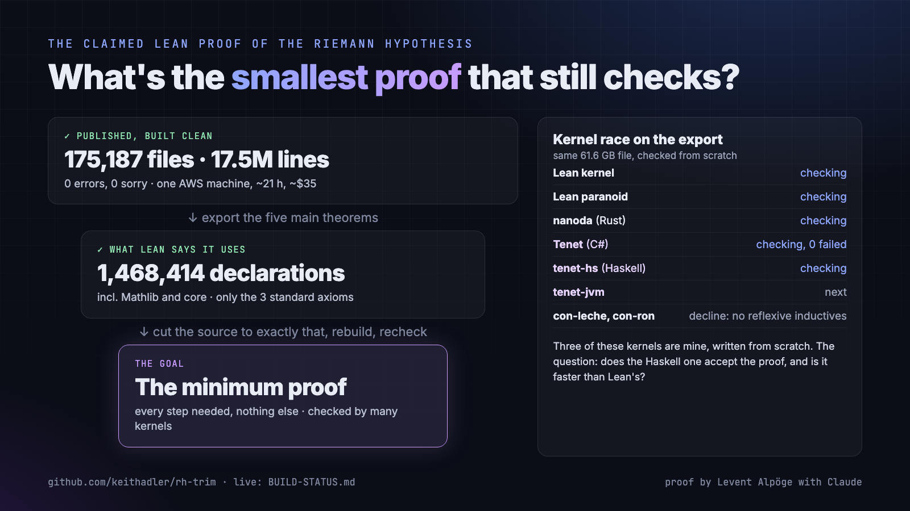

<div align="center">

# rh-trim

### Checking, mapping and shrinking the claimed Lean proof of the Riemann Hypothesis


-accepts%201%2C468%2C414%20decls-1f6f43)


**[Live status](BUILD-STATUS.md)** · **[The smallest proof](docs/MINIFY.md)** · **[Build it yourself](docs/BUILD-ORIGINAL.md)** · **[Proof map](docs/PROOF-MAP.md)**

</div>

<!-- STATUS:BEGIN -->
<div align="center">

**The smallest proof, live** · round 29 · 🔁 REPAIRING · updated 18:33 UTC Nov 22

<table><tr>
<td align="center" width="20%"><sub><b>SMALLER</b></sub><h2>8.6%</h2><sub>in lines, so far</sub></td>
<td align="center" width="20%"><sub><b>LINES</b></sub><h2>15.89M</h2><sub>was 17.37M</sub></td>
<td align="center" width="20%"><sub><b>FILES</b></sub><h2>~32,000</h2><sub>was 175,188 · after merging. Building unmerged (172,318) first, so each error points at an original file</sub></td>
<td align="center" width="20%"><sub><b>THIS ROUND</b></sub><h2>2% built</h2><sub>2,655 of 172,318 files · 335 errors to repair</sub></td>
<td align="center" width="20%"><sub><b>TIME</b></sub><h2>12h 13m</h2><sub>and counting · since the first build, 06:19 UTC Nov 22 · 30 rounds</sub></td>
</tr></table>

<sub>Not confirmed until a round builds with 0 errors. Each round keeps what the last one's build said was missing, so the percentage can only go down from here. Updated every 2 minutes from the build machine. <a href="docs/MINIFY.md#log">Log of every round</a></sub>

</div>
<!-- STATUS:END -->

On 2026-11-20 Levent Alpöge announced a proof of the Riemann Hypothesis, and of GRH for Dirichlet
L-functions, found working with Claude and published as Lean 4 code
([announcement](https://alpo.ge/remark.pdf)): **175,188 files and 17.4 million lines**, with one docstring.

This repository asks three questions about it:

1. **Does it check?** Build it, export it, and run independent kernels on it, including three written from
   scratch: Tenet (C#), tenet-hs (Haskell) and tenet-jvm.
2. **What is it made of?** Measure its structure from Lean's own export: what it uses, what it repeats, and
   which few lemmas carry it.
3. **How small can it be?** Cut it down to only what the five theorems need, then look for a shorter route.

<p align="center"></p>

## 🔑 What we've found

| | |
|---|---|
| ✅ **It builds** | All 175,187 proof files compile on Lean 4.33.1: 0 errors, no `sorry`. One AWS Spot machine, about 21 hours, about $35. |
| ✅ **Tenet accepts it** | My independent C# kernel checked all **1,468,414** declarations with **0 failures** in 1 hour. (nanoda and the latest con-leche also accept it, per [Andrew Sutherland's MIT page](https://math.mit.edu/~drew/grh/).) |
| 🔒 **Only standard axioms** | It rests on `propext`, `Quot.sound` and `Classical.choice`, nothing added by the author. |
| 🎯 **One claim carries it** | **99.35%** of the proof sits under a single claim, `allChi`; then a chain of four lemmas owning 77%, 67% and 43%. |
| 📜 **The statements are small** | What the five theorems *say* rests on just **4,915** declarations, only 5 from the project. Everything else is proof. |
| 🔁 **It repeats itself** | ~96,000 hand-named theorems restate another theorem's statement exactly. |
| 🐢 **A few steps cost the most** | **0.3%** of declarations take **half** the checking time, most of them in p-adic Hodge theory. |
| 🧪 **The checkers catch planted faults** | **431** single faults planted in 8 real slices of the proof, 2,583 kernel checks: every kernel rejected every one. |
| 📏 **It's huge** | 17.4M lines, about **7.6 times Mathlib** (2.3M). Even with all dead code removed it's about 7 times. |
| ⚠️ **Some checkers can't run it** | con-leche and con-ron as bundled with Lean 4.36 decline a reflexive inductive type; tenet-jvm runs out of memory on a file this size (a fix is planned). |

Details, method and caveats for each: [BUILD-STATUS.md](BUILD-STATUS.md#research-on-the-export).
An interactive map of the proof's structure is linked from there.

## ✂️ The smallest proof

<p align="center"></p>

**Goal:** the same five theorems, with everything they don't need removed, rebuilt, and checked by Tenet, then the
other kernels. Live numbers are in the counter at the top; method, lessons and log in **[docs/MINIFY.md](docs/MINIFY.md)**.

| | Lines | Files |
|---|---:|---:|
| Original | 17,374,242 | 175,188 |
| **Now** (not confirmed until a round builds clean) | **15,879,883 (−8.6%)** | 172,315 (about 32,000 after merging) |
| Mathlib, for scale | 2,293,877 | 8,311 |

- **What the 8.6% is:** dead code. About 90,700 unused declarations (59,712 theorems, 29,806 definitions), 2,873
  empty files, 522,000 redundant import lines, and 43,070 repeated theorems pointed at one twin. No mathematics was
  simplified.
- **It's still about 7 times the size of Mathlib.**
- **For kernels, almost nothing changes:** a kernel only ever checks what the five theorems use, and dead code was
  never in that set; 99.7% of the work remains. The proof is big because of what it uses, not because of waste.
- **So the real target is a shorter route through the math.** The biggest single piece is one theta-correspondence
  step that owns 38% of the proof by itself. [The map](docs/MINIFY.md#next-track-searching-for-a-shorter-route).

## 🏗️ Build the original yourself

<p align="center"></p>

```bash
git clone https://github.com/keithadler/rh-trim && cd rh-trim
```

```bash
./build-original.sh ~/rh-build
```

One script, on a throwaway Ubuntu machine: installs Lean, clones the proof at a pinned commit and compiles it
with the network cut off. About 21 hours and $35 on an AWS Spot `m6a.48xlarge`. Step-by-step guide:
[docs/BUILD-ORIGINAL.md](docs/BUILD-ORIGINAL.md). To help build it with others, see the distributed replay at
[rohanarun/alpoge-rh-replay](https://github.com/rohanarun/alpoge-rh-replay).

## 🗺️ What the proof looks like inside

```
five theorems ← short arguments over Mathlib ← ONE KEY CLAIM ← Galois representations ← theta lifts
```

- **The key claim:** no Dirichlet L-function vanishes right of `Re s = 1/2`. RH and the GRH statements follow
  from it by the functional equation, in a few short files.
- **Where it comes from:** Galois representations attached to polarized cuspidal representations, derived from
  **theta lifts** rather than the geometry of Shimura varieties.
- **Nothing from the literature is assumed:** its 162 formal statements of published results are proved inside
  the project ([list](docs/LITERATURE.md)).
- **Seven theorems conclude the key claim:** five form the chain the proof uses; two are side routes it doesn't.

Layer by layer, with files: [docs/PROOF-MAP.md](docs/PROOF-MAP.md). The [Tau Ceti roadmap](https://github.com/TauCetiProject/TauCetiRoadmap/pull/2954)
turns the proof into 41 human-sized targets; [our measured weights for each](docs/TAUCETI-WEIGHTS.md).

## 🚫 What this repository is not

- **Not the proof's code.** It was published without a license, so no Lean source from it is here. The tools
  regenerate everything from the public mirror.
- **Not a verdict on the mathematics.** Kernels accepting a proof says the code checks; it doesn't replace
  mathematicians reading the math.

## 📁 Contents

| Path | What it is |
|---|---|
| [`BUILD-STATUS.md`](BUILD-STATUS.md) | the live page: builds, the kernel race, research results, incident log |
| [`docs/MINIFY.md`](docs/MINIFY.md) | the smallest proof: method, numbers, log, and the shorter-route plan |
| [`docs/BUILD-ORIGINAL.md`](docs/BUILD-ORIGINAL.md), `build-original.sh` | build the original on one cloud machine |
| [`docs/TAUCETI-WEIGHTS.md`](docs/TAUCETI-WEIGHTS.md) | how much of the proof each Tau Ceti sub-roadmap reaches |
| [`docs/PROOF-MAP.md`](docs/PROOF-MAP.md), [`docs/LITERATURE.md`](docs/LITERATURE.md) | the proof's layers, and the published results it proves |
| `data/min/` | the smallest proof's cut lists, merged theorems and added imports |
| `tools/xidx.c`, `tools/xan.c` | index the 61.6 GB export in one pass; trusted base, duplicates, hubs, dominator tree |
| `tools/mutate.py`, `tools/run-mutants.sh` | plant faults in proof slices and race every kernel on them |
| `tools/reach.py`, `prune.py`, `swapcross.py`, `finalize_cuts.py`, `trim_imports.py`, `merge_files.py` | the minification pipeline |
| `tools/render_status.py` | draws the live page |

<details><summary><b>History: the first, source-level reduction (it was wrong)</b></summary>

The first reduction (`make-fork.sh`, `build-linux.sh`, [docs/BUILD.md](docs/BUILD.md)) came from reading source
text: it kept 137,020 files and 12.0 million lines. Building it on AWS showed it missed real dependencies:
dangling `open … in` prefixes, Mathlib-class instances, global theorems mistaken for local names, dot notation.
Fixed, that trace could only safely cut about 9%. So the original was built instead, and its export now gives
the exact list. `make-fork.sh` still reproduces that early reduction byte for byte, but **it does not build**.
Method and mistakes: [docs/PRUNING.md](docs/PRUNING.md).

</details>

## License

The tools, data and documentation here are Apache-2.0. That covers this repository's own files only, not the
proof, whose author has not licensed it.
